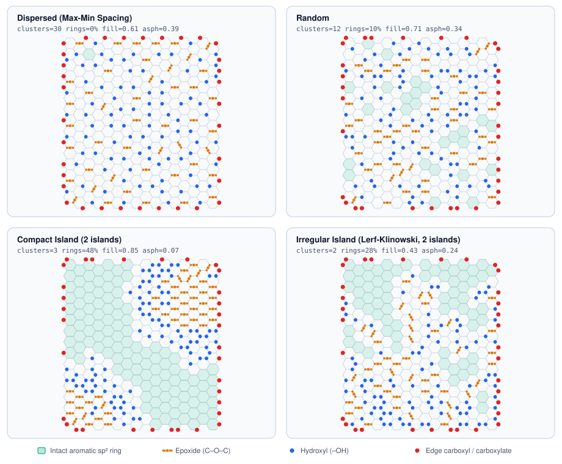

<h1 align="center">GO Workbench</h1>

<p align="center">
  Generate graphene oxide sheets with explicit connectivity, assign Amber parameters and export topologies for Amber, OpenMM or GROMACS.
</p>

<p align="center">
  <a href="https://doi.org/10.5281/zenodo.24119849"></a>
  <a href="https://github.com/CalzaAlessandro/go-surface-workbench/actions/workflows/tests.yml"></a>
  <a href="pyproject.toml"></a>
  
  <a href="LICENSE"></a>
</p>

<p align="center">
  
</p>

## Contents

- [Features](#features)
- [Installation & quickstart](#installation--quickstart)
- [Usage](#usage)
- [Outputs](#outputs)
- [Chemistry & validation](#chemistry--validation)
- [Roadmap](#roadmap)
- [Documentation](#documentation)
- [Citation](#citation)
- [Contributing](#contributing)
- [License](#license)

> [!NOTE]
> Structure generation and the default Amber parameterization (`gaff2_v3` with `L0_v2` charges) are ready for finite graphene oxide sheets functionalized with standard basal and edge oxygen groups, with verified export to Amber, OpenMM and GROMACS. Direct periodic topology writers, additional edge motifs and non-Amber force fields are under active development; see [VALIDATION.md](VALIDATION.md) before running production simulations.

## Features

- **Controllable graphene oxide architectures:** Build rectangular, hexagonal or circular sheets (finite or periodic) with user-defined lateral size, `O/C` or `C/O` oxidation level, pH-aware protonation states and structural vacancies/pores.
- **Tunable spatial oxidation & $\pi$-system control:** Distribute oxygen groups in `dispersed`, `random`, compact `island` or branched Lerf–Klinowski `irregular_island` morphologies, with Clar closed-shell Kekulé and Hückel $\pi$-gap screening enabled by default in the CLI (`--clar` / `--no-clar`, `--min-huckel-gap`).
- **Closed-shell Clar guarantee & edge-acid spacing:** By default, CLI builds (`01_build_GO.py` / `go.py build`) enforce bipartite $sp^2$ sublattice parity (`(N_A - N_B + OH + carbonyl)` even) and a perfect Kekulé matching across all four placement modes so conjugated domains stay closed-shell instead of trapping unphysical unpaired radical sites (use `--no-clar` or `clar = false` only for intentional radical benchmarks). Edge carboxyls (`COOH`/`COO`) also prefer graph spacing $\ge 3$ C–C bonds along perimeters to avoid ortho/bay intra-edge cyclization unless site capacity requires fallback.
- **Built-in structural verification:** Every model retains its authoritative bond graph and passes automated pre-export checks for steric clashes, bond lengths, coordination/valences and net formal charge in linear $O(N)$ runtime up to tens of thousands of atoms.
- **Transferable Amber parameterization:** Assigns `gaff2_v3` bonded/Lennard-Jones parameters and `L0_v2` partial charges using dedicated graphene-oxide atom types designed not to collide with standard biomolecular, solvent or ion libraries (`ff19SB`, `GAFF2`, water, ions), or accepts custom per-atom charges (`--charge-model custom`).
- **Multi-engine & multi-format workflows:** Exports native inputs for **Amber**, **OpenMM** and **GROMACS**, alongside `JSON`, `PDB` (with `CONECT`), `MOL2`, `SDF`, `XYZ`, `EXTXYZ` and `CIF`, plus covalent epoxide functionalization and docking receptor/box preparation.

<picture>
  <source media="(prefers-color-scheme: dark)" srcset="docs/images/placement_modes_dark.svg">
  
</picture>

*Four spatial oxidation morphologies generated on identical `4.0 × 4.0 nm` graphene scaffolds (`O/C = 0.35`, pH `7.4`, `seed = 42`, `2` island nuclei): `dispersed`, `random`, compact `island` and branched Lerf–Klinowski `irregular_island` (`branching = 0.70`), showing preserved aromatic $sp^2$ six-membered domains.*

## Installation & quickstart

Requires **Python 3.11+** (core Python dependencies: `numpy`, `scipy`, `parmed`, `rdkit`, `netcdf4`, pinned in [pyproject.toml](pyproject.toml) and `uv.lock`). From the repository root:

```bash
uv sync --frozen
uv run python examples/quickstart/run_quickstart.py --output-dir work/quickstart
```

When installed from a wheel or source distribution, all workflow stages are also exposed via `python -m go_builder --help`. External programs—such as **AmberTools** (`tleap`, `sander`), **GROMACS**, **OpenMM**, **AutoDock Vina**, **Gaussian** and **xTB**—are optional at install time and only required when running simulation or quantum-chemical steps.

See [Quickstart](docs/QUICKSTART.md), [Installation details](docs/REFERENCE.md#installation--environment-setup) and [Engine setup](docs/ENGINE_SETUP.md).

## Usage

### Build a graphene oxide sheet

Structures can be built from CLI flags, TOML/JSON configuration files ([`examples/configs/`](examples/configs/)), or built-in recipes using [01_build_GO.py](01_build_GO.py):

```bash
# 4 x 4 nm GO sheet at pH 7.4 with two compact oxidized islands and 5% pores
uv run python 01_build_GO.py \
  --size 4 4 --oc 0.35 --ph 7.4 --place island --islands 2 --holes mixed:5 --seed 42 \
  --out work/go.json --pdb work/go.pdb --mol2 work/go.mol2 --sdf work/go.sdf --cif work/go.cif

# Branched Lerf-Klinowski island morphology with closed-shell Kekule filtering
uv run python 01_build_GO.py \
  --size 4 4 --oc 0.35 --ph 7.4 --place irregular_island --islands 2 --branching 0.70 --clar --seed 42 \
  --out work/go_irreg.json

# Generate a template config, build from TOML, list recipes, or run strict integrity checks
uv run python 01_build_GO.py --init-config work/my_go.toml
uv run python 01_build_GO.py --config examples/configs/go_island_porous.toml --out work/island.json
uv run python 01_build_GO.py --list-presets
uv run python check_model.py --model work/go.json --strict
```

### Parameterize and export for MD

Assign force-field parameters with [03_prepare_amber.py](03_prepare_amber.py) and convert to GROMACS ([07_export_gromacs.py](07_export_gromacs.py)) or OpenMM ([08_export_openmm.py](08_export_openmm.py)), with optional covalent epoxide ring opening via [02_open_epoxides.py](02_open_epoxides.py):

```bash
# Build from recipe, assign gaff2_v3 parameters + L0_v2 charges, and assemble with tleap
uv run python 01_build_GO.py --recipe examples/finite_GO.json --output work/finite_GO.json --pdb work/finite_GO.pdb
uv run python 03_prepare_amber.py --model work/finite_GO.json --output-dir work/amber --radii mbondi2 --run

# Convert the Amber topology to GROMACS and OpenMM
uv run python 07_export_gromacs.py --topology work/amber/go.prmtop --coordinates work/amber/go.inpcrd --output-prefix work/gmx/go
uv run python 08_export_openmm.py --topology work/amber/go.prmtop --coordinates work/amber/go.inpcrd --output work/openmm/go.xml
```

Custom user charges can be supplied via `--charge-model custom --charges-json <file>`. The legacy `--preset gaff2_current` option remains available for backwards compatibility. Exported `PDB` and `MOL2` files also support rigid or flexible docking (`AutoDock Vina`, `PatchDock`), while Amber, GROMACS and OpenMM exports cover both gas-phase and explicitly solvated setups.

## Outputs

| Stage | Key files |
|---|---|
| Structure builder | `work/finite_GO.json`, `finite_GO.pdb` (plus optional `.mol2`, `.sdf`, `.xyz`, `.cif`) |
| Amber preparation (`--run`) | `work/amber/go.prmtop`, `go.inpcrd`, `tleap.in`, `GO_gaff2_v3.frcmod`, `v3_libraries/` |
| Reproducibility & provenance | `work/amber/assigned_model.json`, `library_audit.json`, `PROVENANCE.json` |
| GROMACS export | `work/gmx/go.top`, `go.itp`, `go.gro` |
| OpenMM export | `work/openmm/go.xml` |

For the complete flag and script reference, see [docs/REFERENCE.md](docs/REFERENCE.md#scripts--usage-workflow).

## Chemistry & validation

- **Supported chemistry (`gaff2_v3`):** Basal aromatic/graphitic carbons, aromatic `CH` edges, hydroxyls, basal and edge epoxides, edge carbonyls, carboxylic acids and deprotonated carboxylates. Unsupported motifs (such as phenolic `sp2`-OH, planar furanic ethers or edge lactones) are explicitly rejected rather than silently mistyped.
- **Verification scope:** Built geometries are checked automatically for topological and coordination validity (`geometry_status = "constructed_unrelaxed"`). Cross-engine Amber, OpenMM and GROMACS energy/force parity, vibrational stability and library SHA-256 integrity are continuously verified by the automated test suite; details, benchmark tables and known limitations are documented in [VALIDATION.md](VALIDATION.md) and [docs/PERFORMANCE.md](docs/PERFORMANCE.md).

## Roadmap

- **Available now:** Sheet construction, spatial oxidation & pore modes (including branched Lerf–Klinowski islands and `--clar` Kekulé screening), $O(N)$ structural checks, `gaff2_v3` + `L0_v2` Amber parameterization, custom charges, multi-format exports, covalent epoxide opening and docking preparation, plus cross-engine GROMACS and OpenMM exporters.
- **In progress:** Large-sheet quantum-chemical electrostatic benchmarks, charge regularization refinements and expanded edge-oxygen support (phenols, planar ethers, lactones).
- **Planned:** Direct periodic topology writers (`GROMACS`, `OpenMM`, `Amber`, `OpenFF`), additional force-field presets (`OPLS-AA`, `OpenFF`, `CHARMM36m`) and automated explicit-solvent MD/solvation helpers.

## Documentation

| Topic | Guide |
|---|---|
| First example | [Quickstart](docs/QUICKSTART.md) |
| Commands and complete workflows | [Command reference](docs/REFERENCE.md) |
| Validation and limitations | [Validation status](VALIDATION.md) |
| Charge models and presets | [Charge presets](docs/CHARGE_PRESETS.md) |
| Force-field presets and references | [Force-field presets & references](docs/REFERENCE_AND_PRESETS.md) |
| Feature comparison vs literature | [Comparison](docs/COMPARISON.md) |
| Scaling timings | [Benchmarks](docs/PERFORMANCE.md) |
| Covalent functionalization | [Fragments](docs/FRAGMENTS.md) |
| External programs | [Engine setup](docs/ENGINE_SETUP.md) |
| Trajectory alignment | [Alignment](docs/ALIGNMENT.md) |
| Third-party notices and datasets | [Third-party licenses](THIRD_PARTY.md) |

## Citation

If you use this software or its parameter libraries, please cite:

Alessandro Calza (2026). *GO Workbench*, version 0.1.0.
[DOI: 10.5281/zenodo.24119849](https://doi.org/10.5281/zenodo.24119849).

Citation metadata is available in [CITATION.cff](CITATION.cff).

<details>
<summary>BibTeX</summary>

```bibtex
@software{Calza2026GOWorkbench,
  author = {Alessandro Calza},
  title = {GO Workbench},
  version = {0.1.0},
  year = {2026},
  doi = {10.5281/zenodo.24119849},
  url = {https://github.com/CalzaAlessandro/go-surface-workbench}
}
```

</details>

## Contributing

See [CONTRIBUTING.md](CONTRIBUTING.md) for development setup and checks. Bug reports and feature requests are welcome via [GitHub Issues](https://github.com/CalzaAlessandro/go-surface-workbench/issues).

## License

Original source code, parameter libraries generated for this project and documentation are distributed under the [Apache License, Version 2.0 (Apache-2.0)](LICENSE). Third-party software and external reference datasets in `resources/reference/` retain their original terms and attribution; see [THIRD_PARTY.md](THIRD_PARTY.md).
