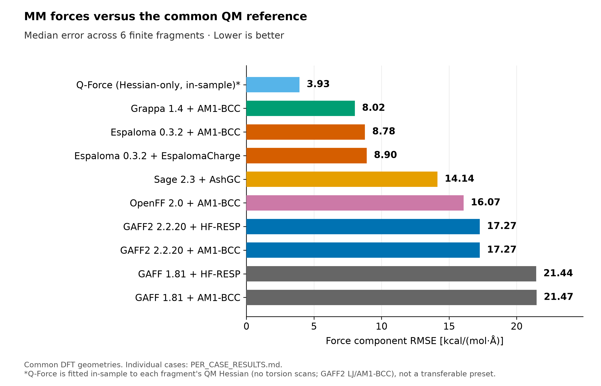
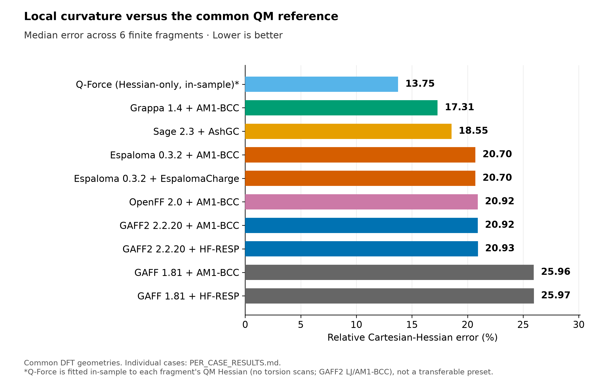
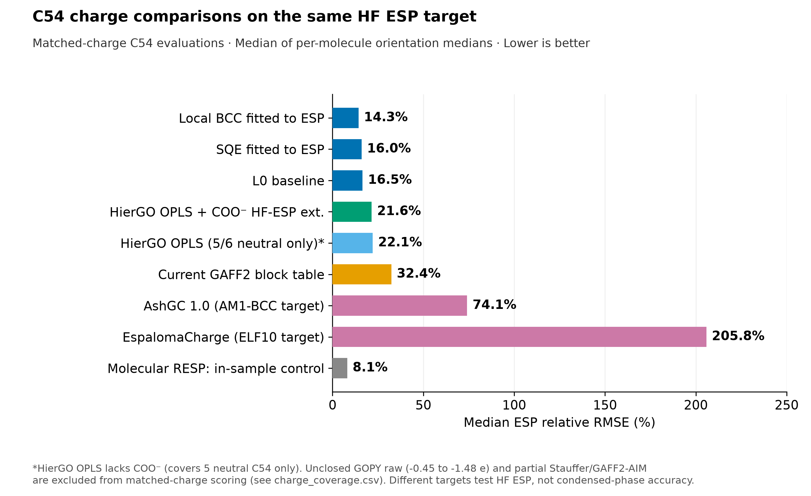
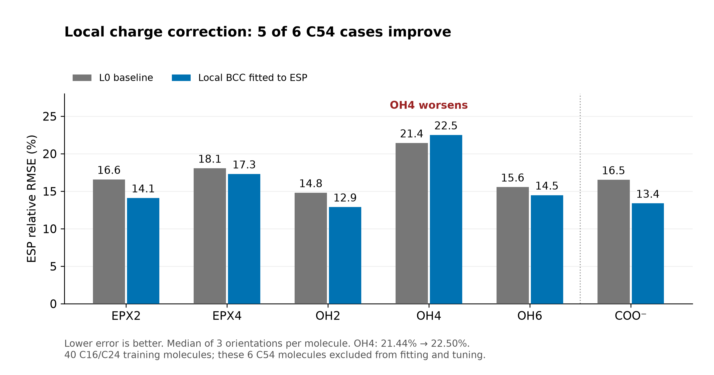
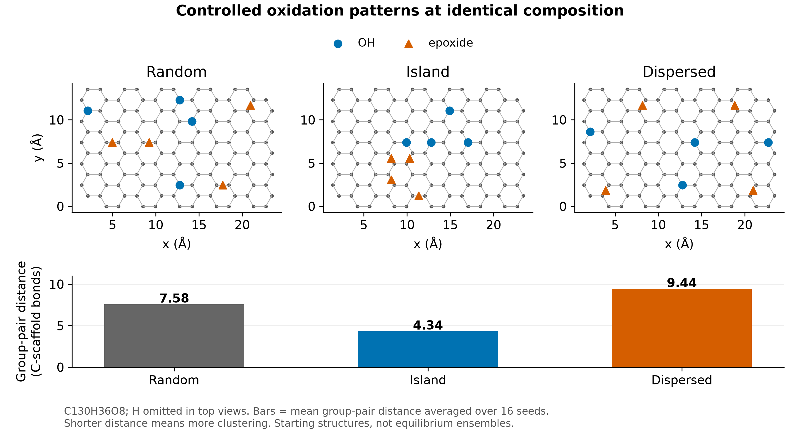

# QM, charge and construction pilot — 13 November 2026

> [!NOTE]
> **Historical 6-fragment pilot (13 November 2026):** For the updated 58-fragment expanded audit
> (including blocked pre-`L0_v2` charge candidates and current production status), see
> [docs/CHARGE_PRESETS.md](../../../docs/CHARGE_PRESETS.md) and
> [docs/REFERENCE_AND_PRESETS.md](../../../docs/REFERENCE_AND_PRESETS.md).

Grappa is the leading **bonded-validation candidate** on this six-fragment
panel. A local ESP-trained charge correction transfers better than the frozen
L0 baseline to five of six C54 molecules. These results support further testing;
they do not establish a preferred force field for solvated GO, adsorption,
proteins or DNA. Production CLI defaults have not changed.

## Parameter combinations against a common QM reference

The panel contains pyrene, cis/trans pyrene diol, diol–epoxide, COOH and COO⁻
fragments: six graphs, 26–31 atoms, five neutral and one anion. Each combination
uses the **same archived wB97X-D/6-311++G(d,p) gas-phase geometry and derivatives**.
No absolute QM/MM total-energy comparison is made. Pretrained-model training
overlap has not been checked, so this is not an independent holdout claim for
Grappa, Espaloma or OpenFF.

| Complete combination used in this pilot | Median force RMSE, kcal/(mol·Å) | Median Cartesian-Hessian error, % |
|---|---:|---:|
| GAFF 1.81 / AM1-BCC | 21.472 | 25.96 |
| GAFF 1.81 / HF-RESP | 21.444 | 25.97 |
| GAFF2 2.2.20 / AM1-BCC | 17.270 | 20.92 |
| GAFF2 2.2.20 / HF-RESP | 17.270 | 20.93 |
| OpenFF 2.0.0 / AM1-BCC | 16.070 | 20.92 |
| Sage 2.3.0 / AshGC 1.0 | 14.137 | 18.55 |
| Grappa 1.4.0 bonded / OpenFF 2.0.0 nonbonded / AM1-BCC | 8.021 | 17.31 |
| Espaloma 0.3.2 bonded / OpenFF 2.0.0 nonbonded / AM1-BCC | 8.775 | 20.70 |
| Same Espaloma bonded and nonbonded terms / EspalomaCharge | 8.901 | 20.70 |
| **Q-Force 0.6.14 (Hessian-only fit, in-sample control)\*** | **3.928** | **13.75** |

`*` **Q-Force scope caveat:** `QForce_Hessian_only_GAFF2_LJ_AM1BCC` is fitted
directly in-sample to each fragment's own QM Cartesian Hessian (using validated
chemical-graph bond orders plus the benchmark GAFF2 LJ and AM1-BCC charges, with
**no flexible torsion scans**). It is therefore a molecule-specific in-sample
Hessian-fitting control rather than a transferable preset.

Each median gives equal weight to six molecules, after calculating a score per
molecule. Raw cases, including the large GAFF diol errors, are retained in
[mm_per_case.csv](data/mm_per_case.csv); see [mm_summary.csv](data/mm_summary.csv).
The Grappa package is version 1.5.0; the checkpoint is **1.4.0**.





The bars summarize medians; [readable per-case tables](PER_CASE_RESULTS.md)
retain every molecule and outlier alongside the source CSV files.

The ranking depends on the summary statistic. Among transferable combinations,
Espaloma/AM1-BCC has a lower **mean** force error than Grappa, 8.810 versus
10.641 kcal/(mol·Å): Grappa's two diol cases have force errors 17.8–18.2, versus
7.8–8.3 for Espaloma. Conversely, Espaloma's diol Hessian errors are 45–46%,
versus 21% for Grappa. Mean Hessian errors are 27.73% for Espaloma and 18.25%
for Grappa (and 14.18% for the Q-Force in-sample Hessian control, with mean
force RMSE 3.968 kcal/(mol·Å)). Both means and medians are distributed in the
summary CSV; there is no single winner across every case, metric and aggregation.

Force RMSE is the square root of the mean squared difference over all 3N
Cartesian force components. Curvature error is
100 × ‖H_MM − H_QM‖F / ‖H_QM‖F, using unweighted Cartesian Hessians.
The Hessian is evaluated at the QM geometry; it is **not** a comparison of
vibrational spectra at separately optimized MM minima. Harmonic curvature alone
does not test torsional barriers, conformational populations or distant minima.

## Charge transfer to larger fragments

The six C54 evaluation graphs were excluded from our strict40 C16/C24 fits.
They contain two epoxide, three hydroxyl and one carboxylate case. The C54 label
counts scaffold carbons, not all atoms. These molecules had already been
inspected in earlier SQE exploration: they are held out from fitting, rather
than a newly blinded prospective test. Overlap with pretrained charge-model
training data is unverified.

All methods are scored on the same archived HF/6-31G* MK ESP grids at accepted
DFT geometries. RRMS is ESP RMSE divided by the RMS reference potential; the
reported percentage is 100 × RRMS. First take the median of three orientations
within each molecule, then the median across molecules. Rotations are not
independent molecular replicates. Neutral and ionic subsets are reported
separately because the net ionic potential changes the denominator.

| Charge assignment | All six, median RRMS % | Five neutral, median RRMS % | One COO⁻, RRMS % |
|---|---:|---:|---:|
| Frozen L0 strict40 | 16.55 | 16.58 | 16.52 |
| L0 + local ESP-trained bond increments | 14.29 | 14.48 | 13.39 |
| Frozen SQE fitted directly to ESP | 16.02 | 16.06 | 12.19 |
| `HierGO_OPLS_COO_HF_ESP_extension` (charge-only ext.) | 21.56 | 22.13 | 16.62 |
| `hiergo_opls` (5/6 neutral only; COO⁻ omitted) | — | 22.13 | not covered |
| `current_gaff2` (user block-charge table) | 32.39 | 32.48 | 18.96 |
| AshGC 1.0 | 74.10 | 75.29 | 25.76 |
| EspalomaCharge 0.0.8 | 205.83 | 209.27 | 43.00 |
| Molecular RESP fitted on these same grids: in-sample control | 8.08 | 8.28 | 1.17 |



AshGC approximates AM1-BCC ELF10 charges; EspalomaCharge also targets AM1-BCC
ELF10. Their larger HF ESP errors do not establish that the complete Sage or
Espaloma force fields are worse in condensed phases. In this pilot they are
not preferred as direct substitutes for our GO-specific HF ESP charge model.
The molecular RESP row is a fitted reference control, not a transfer predictor
or a guaranteed mathematical error lower bound.

Published GO charge tables were also audited for role coverage and formal-charge
conservation ([charge_coverage.csv](data/charge_coverage.csv)):
- **`hiergo_opls` and `HierGO_OPLS_COO_HF_ESP_extension`:** HierGO's 17-row
  `Oplsatom2` table covers the five neutral C54 graphs with exact zero total
  charge (**22.13%** median RRMS, outperforming `current_gaff2`'s **32.48%**),
  but omits `COO⁻`. Keeping all 17 non-COO HierGO charges intact, we fitted a
  separately named 2-parameter `COO⁻` block (`COO_anchor = −0.654330 e`,
  `COO_C = +1.727593 e`, `COO_O = −1.036631 e`, exact `−1.0 e` block sum; normal
  matrix condition 57.35, ridge 0) against orientation-001 HF/6-31G* ESP on 10
  non-C54 `COO⁻` fragments. Held out on C54, this extension scores **16.62%**
  on `COO⁻` and **21.56%** overall across all six molecules.
- **OPLS-AA `C_aromatic–COO⁻` bonded/LJ audit:** Inspecting standard GROMACS
  `oplsaa.ff` (`ffnonbonded.itp`, `ffbonded.itp`) shows that OPLS-AA defines
  aliphatic carboxylate types (`opls_271` `C_3`, `opls_272` `O2`), `C_3–CA` and
  `C_3–O2` bonds, `O2–C_3–O2` and `C_3–CA–CA` angles, and `improper_O_C_X_Y`,
  **but lacks aromatic carboxylate junction terms** (`CA–C_3–O2` angle and
  `CA–CA–C_3–O2` proper dihedral). `HierGO_OPLS_COO_HF_ESP_extension` is
  therefore a **charge-only research extension**, not a complete validated
  OPLS-AA `COO⁻` force field.
- **`gopy_raw`, `stauffer_*`, and `pinto_gaff2_aim`:** Raw GOPY motif charges
  (`hydroxyl`, `epoxide`, `COOH`) do not sum to zero (`−0.454` to `−1.476 e`
  total charge error on neutral C54, yielding unphysical 293%–729% diagnostic
  RRMS) and omit `COO⁻`, so they are excluded from matched-charge scoring.
  Stauffer `ESP`/`SESP` supply only basal OH/epoxide entries (6–18 of 74–84
  atoms; missing scaffold and finite edge caps). `pinto_gaff2_aim` (`GAFF2–AIM`)
  contains periodic DDEC6 + AIM LJ (`GO_18`/`GO_30`) and is retained as a
  periodic literature reference without automatic finite-fragment transfer.

The local correction adds equal/opposite increments for 36 unordered bonded
role pairs to frozen L0 charges, conserving total charge. It was fitted to the
40 C16/C24 molecules, one orientation each, minimizing equal-molecule mean
RRMS² with ridge 10⁻⁴ fixed before C54 scoring. The unregularized normal matrix
has rank 35/36 and condition number 4.26 × 10¹⁸; regularization selects a
solution in this underdetermined model. Increments range from −0.508 to
+0.577 e and were not clipped. It is a **GO-specific research correction**,
not standard AM1-BCC or ABCG2.



The OH4 worsening is retained: **21.44% → 22.50%**. Atom reindexing and total
charge were checked. Published charge models passed atom-permutation checks
within 10⁻⁷ e and conserve charge within 4.3 × 10⁻⁶ e in float32; their outputs
were not subsequently renormalized. EspalomaCharge uses the published readout
with `q_ref = formal_charge` to preserve ionic charge, rather than a neutral-only
default. All scores are in [charge_per_case.csv](data/charge_per_case.csv),
[charge_summary.csv](data/charge_summary.csv) and
[charge_coverage.csv](data/charge_coverage.csv).

## Oxidation patterns and experimental constraints

The unchanged builder generated **48 valid C130H36O8 structures**: 16 seeds
each for random, island and dispersed placement, always four OH and four
epoxides. Island anchors lie in a hard 6 Å disk; dispersed placement maximizes
the minimum scaffold graph distance greedily. Both use explicit-site recipes.
No constraint is silently relaxed. They are starting-structure controls, not
kinetic growth models or equilibrium samples.



The mean across seeds of the mean group-pair shortest graph distance is
7.583 bonds for random, 4.337 for islands and 9.444 for dispersed placement.
The bars show the **mean across 16 seeds**; per-seed ranges are tabulated.
Distance between two
groups is the shortest C-scaffold path between their anchor sets.
[Raw pattern data](data/pattern_per_case.csv) and
[representative graphs](data/pattern_examples.json) are provided.

An integer-composition prototype also generated eight feasible models and
correctly reported four deliberately infeasible requests. Four feasible
examples use an illustrative O/C interval 0.08–0.10; four use the P935 vendor
dry-mass limits C 64–65 wt% and O 33–34 wt%, converted to atomic O/C
**0.381–0.399**. The final atom counts, including extra carboxyl carbon when
present, define the ratio. See [constraint outcomes](data/composition_constraints.csv).

The [manufacturer TDS, revision 20.12.21](https://filgen.jp/Product/Bioscience4/Abalonyx/TDS_GO_Pastes_and_powders.pdf)
is an experimental composition reference. These are **elemental-only P935
demonstrations**: the OH:epoxide ratio 0.8–1.2 and absence of edge oxygen groups
are illustrative assumptions. The TDS actually reports carbonyl/carboxyl
signatures; our approximately 2 nm fragments also do not reproduce its
300–3000 nm primary-sheet size range. The examples are not full P935 models.
Paste-product titration/zeta data must not be assigned to the P935 powder.

Clustering has literature support under specified conditions, including
[Mouhat, Coudert and Bocquet (2020)](https://doi.org/10.1038/s41467-020-15381-y).
HierGO already offers circular bunching; MakeGraphitics includes reactivity-
weighted growth and island nucleation. The
[modeller catalogue](../../../docs/COMPARISON.md) records their capabilities
and Workbench gaps without claiming novelty for a circular mask.

## Recommendations and validation boundaries

| Purpose | Candidate to carry forward | Reason and remaining evidence |
|---|---|---|
| Conventional Amber comparison | GAFF2 / AM1-BCC and GAFF2 / HF-RESP | Declared conventional controls; this panel favors GAFF2 over GAFF, not a universal accuracy claim |
| Learned bonded parameters | Grappa 1.4.0 / OpenFF 2.0 nonbonded / AM1-BCC | Lowest median force and curvature errors among transferable models; next test torsions, larger sheets and graft junctions |
| Alternative learned bonded parameters | Espaloma 0.3.2 with declared OpenFF 2.0 nonbonded | Low force error; EspalomaCharge adds no consistent advantage here |
| Complete OpenFF combination | Sage 2.3.0 / AshGC | Native coupled combination; preserve it as such, despite the separate GO HF ESP mismatch |
| Molecule-specific Hessian control | Q-Force 0.6.14 (Hessian-only fit, GAFF2 LJ/AM1-BCC) | Reproduces QM forces/Hessians best in-sample (`3.928 kcal/(mol·Å)`, `13.75%`); not transferable and no torsion scans |
| Fast GO-specific charge transfer | L0 + local ESP-trained increments | Improves 5/6 C54; OH4 worsens; new chemistry, size and solvent tests remain |
| Published OPLS charge extension | `HierGO_OPLS_COO_HF_ESP_extension` (charge-only) | Preserves HierGO's 17 roles and fills its missing `COO⁻` on HF ESP; needs OPLS-AA `CA-C_3-O2`/`CA-CA-C_3-O2` bonded & solvation validation |
| Experimental construction | Families satisfying measured intervals | Retain uncertainty and alternative spatial patterns; do not infer a unique structure |

A [preset catalogue and custom-mixing design](../../../docs/REFERENCE_AND_PRESETS.md)
records charges, bonded/nonbonded sources and conventions. These combinations
were exercised in isolated research workers; the production CLI does not yet
offer this general preset bank. A general transferable DFT-fitted bonded preset
beyond the 6-fragment Q-Force Hessian-only pilot remains planned, without a
score. No new RESP2, MBIS or DDEC6 derivations were run.

Finite QM is a useful reference for local bonded environments, electrostatics
and graft fragments when size, edge, protonation and spin sensitivity are
controlled. Published periodic QM can test basal-plane structure or mechanics
under comparable composition and boundary conditions; finite and periodic
absolute energies should not be pooled into one score. Experimental XPS,
elemental analysis, titration, AFM and XRD constrain different observables.
AFM apparent height is not covalent thickness, XRD spacing needs a multilayer
model, and zeta potential is not an atomic partial charge.

Before changing a default, validate broader chemistry and sizes, torsional
profiles and conformer energies, GO–water/solute interactions, relevant
experimental observables, and explicit covalent junctions. For protein/DNA
systems, also check parameter isolation and cross interactions. The present
pilot provides none of those condensed-phase or graft validations.

## Verification, provenance and reproduction

- All 18 original QM files passed SHA-256 checks. Independently mass-weighting
  and projecting their Cartesian Hessians reproduces Gaussian frequencies to
  approximately 2.9 × 10⁻⁵ cm⁻¹ RMS.
- MM Hessians passed a two-step central-difference comparison, symmetry checks
  and an independent directional energy/force derivative check.
- All 538 transferred parameter/result files passed SHA-256 verification.
  All 54 force metrics were recomputed on a second machine with OpenMM's
  Reference platform, and all Hessian metrics were recalculated from arrays.
- All 54 transferable systems passed **OpenMM → Amber prmtop → OpenMM** numerical round trips
  at identical coordinates. Maximum energy difference: 1.33 × 10⁻⁵ kJ/mol;
  maximum force-component difference: 2.91 × 10⁻⁴ kJ/(mol·nm). This does not
  constitute a native `sander` execution comparison.
- All 6 Q-Force Hessian-only models (`QForce_Hessian_only_GAFF2_LJ_AM1BCC`,
  fitted with validated explicit chemical-graph bond orders because archived
  Gaussian jobs lacked NBO bond indices) passed native Q-Force versus exported
  GROMACS-in-OpenMM comparison across 3 jittered poses per molecule (`nrexcl=3`,
  deduplicated 1–4 pairs, full-precision parameter export). Maximum force
  difference: 5.89 × 10⁻⁶ kJ/(mol·nm); maximum relative energy difference:
  5.68 × 10⁻¹⁰ kJ/mol.
- Published charge tables (`current_gaff2`, `hiergo_opls`, `gopy_raw`,
  `stauffer_esp`, `stauffer_sesp`) and `HierGO_OPLS_COO_HF_ESP_extension`
  (fitted only on 10 non-C54 `COO⁻` fragments, C54 excluded) were audited for
  role coverage and formal-charge conservation on the same SHA-256-verified
  C54 HF/6-31G* grids and cross-checked point-wise against `compare_esp`.
- Espaloma charge variants have exactly identical bonded and LJ terms;
  the GAFF and GAFF2 charge variants do too. Charge swaps include nonbonded
  exception products, rather than changing particle charges alone.
- AmberTools antechamber MOL2 charge rounding was checked and the supplied
  vector restored before LEaP without changing atom types. Archived AM1-BCC
  rounding residuals up to 0.002 e were closed by a recorded equal shift, at
  most 7.7 × 10⁻⁵ e per atom. These derived vectors are labelled `closed`.
- GAFF 1.81 / GAFF2 2.2.20 identities come from actual LEaP loading logs.
  Global parameter-file hashes are unavailable from the containerized runtime;
  generated topology and loading-log hashes are retained instead.
- Espaloma's legacy runtime required two recorded compatibility adaptations:
  postponed obsolete QCPortal annotations, and exact CSR adjacency in place of
  an unavailable DGL sparse extension. Adjacency was checked against RDKit.
  No inference weights or neural-network equations were changed.

[provenance.json](data/provenance.json) records runtime/model versions, hashes,
charge targets and export limits; [verification.json](data/verification.json)
contains derivative and second-machine checks. Detailed raw QM files,
topologies, fitted coefficients and failed attempts remain in the project
research archive; this compact repository bundle contains the reader-facing
tables and plotting inputs, not a self-contained parameterization rerun.
The recorded per-method setup times cover different operations and are not a
fair timing benchmark.

Rebuild all five PNG/SVG figure pairs from this checkout:

```bash
uv run --project research/benchmarks/2026-11-13 --locked \
  python research/benchmarks/2026-11-13/make_figures.py
```

[FIGURE_MANIFEST.json](FIGURE_MANIFEST.json) records source-table and figure
hashes. Figures use all declared cases, no inferred confidence intervals, opaque
backgrounds and labelled bars with companion per-case tables. These are general README figures, without
a journal-specific compliance claim.

Method references: [Grappa](https://doi.org/10.1039/D4SC05465B),
[Espaloma](https://doi.org/10.1039/D4SC00690A),
[Sage 2.3.0 / AshGC](https://doi.org/10.1021/acs.jctc.6c00169).
The plotting workflow used the `scientific-visualization` skill from Kassis,
Agarwal, He, Patel and Brueckner (2026),
[Scientific Agent Skills](https://doi.org/10.48550/arXiv.2609.00065).
